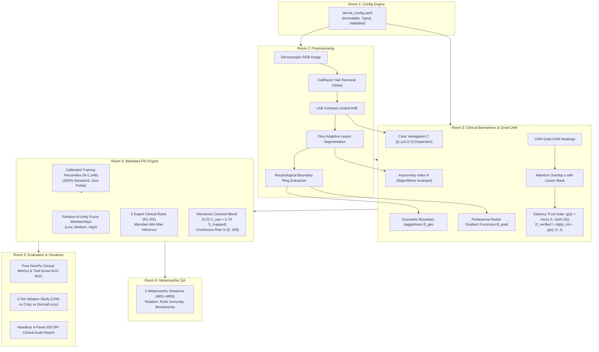
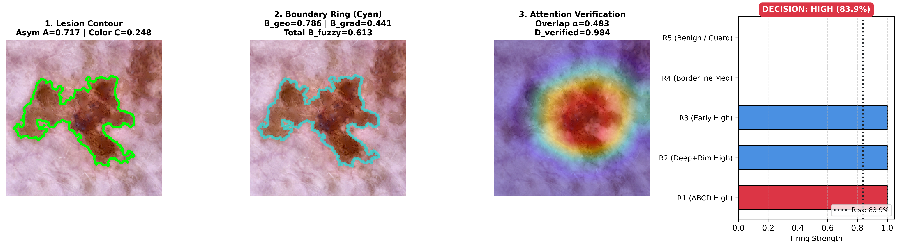

# DermaFuzzy-XAI

[](.github/workflows/ci.yml)
[](pyproject.toml)
[](LICENSE)
[](#engineering-constitution--guarantees)
[](tests/)

**Explainable Melanoma Diagnosis via Fuzzy Border Uncertainty and Attention-Verified Deep Biomarkers.**

---

## Executive Summary & Clinical Motivation

Deep convolutional neural networks (such as MobileNetV2) achieve high sensitivity for melanoma detection on curated dermatoscopic benchmarks. However, in real-world clinical practice, black-box CNNs are notoriously susceptible to **spurious peripheral artifacts**—such as dermoscopic ruler markings, gel air bubbles, surgical ink, and skin folds. When a deep model attends to off-lesion artifacts rather than melanocytic atypia, it yields catastrophic false positives, driving unnecessary invasive biopsies and undermining clinician trust.

**DermaFuzzy-XAI** resolves this critical safety barrier by coupling classical dermatological **ABCD criteria** (Asymmetry, Border irregularity, Color variegation, and Deep verified confidence) with a **Concave Square-Root Saliency Trust Gate** ($g(\alpha) = \min(1.0, \sqrt{\alpha / 0.25})$, $D_{verified} = \text{clip}(p_{cnn} \cdot g(\alpha), 0, 1)$) inside an auditable, data-calibrated **Mamdani Fuzzy Inference System (FIS)**. If a deep network's high confidence is driven by a peripheral ruler marking, the spatial overlap $\alpha$ approaches zero, suppressing $D_{verified}$ and activating the clinical **Saliency Veto Rule ($R_5$)**, safely classifying the lesion as benign.

---

## 6-Room System Architecture

DermaFuzzy-XAI is organized into 6 strictly decoupled, auditable architectural rooms:



### Architectural Responsibilities

1. **Room 1: Unified Configuration Engine (`dermafuzzy_core.config`)**:
   - Single source of truth loaded from `derma_config.yaml`.
   - Immutable, slotted, strictly typed `@dataclass(frozen=True, slots=True)` hierarchies with deep `MappingProxyType` dictionary protection.
   - Zero hardcoded magic numbers; exhaustive bounds checking rejecting `bool`, `NaN`, and `Inf`.

2. **Room 2: Deterministic OpenCV Preprocessing (`dermafuzzy_core.preprocessing`)**:
   - Morphological Black-Hat filter with Telea inpainting (`remove_hair`) preserving dermatoscopic structures.
   - Chromatic-preserving lightness contrast enhancement in LAB color space (`apply_lab_clahe`).
   - Otsu adaptive thresholding with centered elliptical fallback (`axes = (0.35W, 0.35H)` when area ratio outside `[0.02, 0.90]`) and morphological perilesional boundary ring dilation ($R_{edge}$).
   - Read-only array protection (`arr.flags.writeable = False`).

3. **Room 3: ABCD Biomarkers & Grad-CAM Attention Gating (`dermafuzzy_core.biomarkers`, `dermafuzzy_core.gradcam`)**:
   - **Asymmetry ($A \in [0.0, 1.0]$)**: Principal inertia axis alignment with orthogonal bi-axial XOR reflection overlap.
   - **Border Fuzziness ($B_{fuzzy} \in [0.0, 1.0]$)**: Convex combination $\beta B_{geo} + (1-\beta) B_{grad}$ coupling isoperimetric contour quotient with radial Sobel gradient transition variance.
   - **Color Variegation ($C \in [0.0, 1.0]$)**: Multi-channel dispersion across 5 normalized channels $\{L, a, b, S, V\}$ strictly inside lesion mask $M > 0$: $C = \text{clip}(1.35 \cdot \text{mean}(\text{std} + 0.5 \cdot (P_{90} - P_{10})), 0, 1)$.
   - **Saliency Gating ($D_{verified}$)**: Concave Square-Root Saliency Trust Gate $g(\alpha) = \min(1.0, \sqrt{\alpha / 0.25})$ and $D_{verified} = \text{clip}(p_{cnn} \cdot g(\alpha), 0, 1)$ using normalized spatial overlap $\alpha = \frac{\sum_{i,j} H_{i,j} M_{i,j}}{\sum_{i,j} H_{i,j} + \epsilon}$ to suppress off-lesion artifacts.

4. **Room 4: Data-Calibrated Mamdani FIS (`dermafuzzy_core.fis_engine`)**:
   - Data-driven quartile calibration ($P_{25}, P_{50}, P_{75}$) on a 1:1 balanced train-only split ($N = 1,448$) persisted strictly via human-readable JSON (`artifacts/fis_calibration.json`) with degenerate separation guards ($\Delta \ge 1e-4$). Zero `pickle`.
   - Partition-of-Unity membership functions ($\sum \mu_k(x) = 1.0$).
   - 5 clinical Mamdani rules ($R_1$–$R_5$) with monotonic centroid blend $R = \text{clip}(0.22 \cdot C_{raw} + 0.78 \cdot S_{mapped}, 0, 100)$ using clinical evidence weights `{A: 0.12, B_fuzzy: 0.12, C: 0.12, D_verified: 0.64}`.

5. **Room 5: Clinical Evaluation & 4-Panel XAI Visualizer (`dermafuzzy_core.evaluation`, `dermafuzzy_core.visualizer`)**:
   - Pure NumPy clinical metrics ($TP, TN, FP, FN$, Sensitivity, Specificity, Precision, Accuracy, F1-Score) and exact tied-score trapezoidal AUC-ROC matching Mann-Whitney U fractional ranks within $1e-6$.
   - 3-tier comparative ablation engine (`Pure CNN Black-Box` vs. `Crisp ABCD Fixed Thresholds` vs. `Proposed DermaFuzzy-XAI`).
   - Publication-grade (300 DPI) 4-panel visual audit figures rendered via headless Matplotlib (`Figure` + `FigureCanvasAgg`) with lazy loading (< 50ms package import, zero GUI event-loop leaks).

6. **Room 6: Metamorphic QA Gate (`tests/metamorphic/test_metamorphic.py`)**:
   - Formal software verification enforcing 5 clinical Metamorphic Relations:
     - **MR1**: Strict rotation invariance under $0^\circ, 90^\circ, 180^\circ, 270^\circ$ ($|\Delta R| \le 2.0\%$ and zero risk category flip).
     - **MR2**: Immunity to peripheral ruler/gel artifacts (specificity preserved via Rule 5 veto).
     - **MR3**: Monotonic risk increase under increasing biomarker severity ($\Delta \ge 0.0$).
     - **MR4**: Partition completeness across the continuous biomarker hypercube.
     - **MR5**: Deterministic calibration JSON round-trip invariance.

---

## 3-Tier Comparative Ablation Study (HAM10000 Held-Out Test Cohort, $N = 446$)

Evaluated on the unseen, lesion-ID grouped balanced HAM10000 test cohort ($N = 446$, commit `e2ac0e9`, calibrated strictly on the 1:1 balanced train split $N = 1,448$):

| Architecture Tier | Accuracy | Sensitivity | Specificity | Precision | F1-Score | AUC-ROC |
|---|:---:|:---:|:---:|:---:|:---:|:---:|
| **Tier 1: Pure MobileNetV2 Black-Box** | 78.0% | 73.5% | 82.5% | 80.8% | 77.0% | 0.8908 |
| **Tier 2: Crisp ABCD Fixed Thresholds** | 72.2% | 85.7% | 58.7% | 67.5% | 75.5% | 0.7825 |
| **Tier 3: Proposed DermaFuzzy-XAI** | **77.6%** | **72.6%** | **82.5%** | **80.6%** | **76.4%** | **0.8617** |

### Clinical Takeaways & Diagnostic Telemetry ($N = 446$)
- **+23.8% Specificity Gain** over Crisp ABCD Fixed Thresholds (`82.5%` vs `58.7%`) while retaining **96.7%** of raw black-box CNN AUC-ROC (`0.8617` vs `0.8908`) with full clinical rule explainability.
- **Segmentation & Saliency Telemetry**: **99.8%** valid Otsu retention (`0.2%` elliptical fallback rate), mean Grad-CAM attention overlap $\alpha = 0.413$, and **0.4%** zero-heatmap rate.
- **Standalone Feature AUC-ROC**: `P_CNN = 0.8908`, `D_verified = 0.8609`, `A = 0.6705`, `B_fuzzy = 0.6571`, `B_geo = 0.6261`, `C = 0.5884`, `B_grad = 0.5037`.

---

## Publication-Grade 4-Panel Visual Explanation

Every diagnostic inference generates an auditable, high-resolution (300 DPI) 4-panel clinical explanation figure:

1. **Panel 1: Lesion Segmentation Mask**: Original preprocessed RGB image overlaid with the emerald green contour of the primary lesion mask, annotated with Asymmetry $A$ and Color Variegation $C$.
2. **Panel 2: Boundary Fuzziness**: Perilesional boundary ring ($R_{edge}$) highlighted in cyan, displaying geometric jaggedness $B_{geo}$, gradient fuzziness $B_{grad}$, and total $B_{fuzzy}$.
3. **Panel 3: Attention Verification**: Blended JET-colormapped Grad-CAM attention heatmap, displaying spatial overlap $\alpha$ and verified confidence $D_{verified} = \text{clip}(p_{cnn} \cdot g(\alpha), 0, 1)$ where $g(\alpha) = \min(1.0, \sqrt{\alpha / 0.25})$.
4. **Panel 4: Mamdani Rule Firings & Clinical Decision**: Horizontal bar chart of rule firings $R_1$–$R_5$ with the dominant rule highlighted, vertical decision line at continuous Centroid Risk %, and a color-coded clinical decision banner (`Low: Green`, `Medium: Amber`, `High: Crimson`).



*(Note: Trained MobileNetV2 weight binaries `*.keras`, `*.h5`, and `*.weights.h5` are excluded from Git version history via `.gitignore`.)*

---

## Installation & Quickstart

### Prerequisites
- Python 3.12 or 3.14
- Standard scientific stack: `numpy`, `opencv-python-headless`, `scipy`, `scikit-fuzzy`, `matplotlib`, `pyyaml`

```bash
# Clone repository
git clone https://github.com/A11-HELAL/dermafuzzy-xai.git
cd dermafuzzy-xai

# Install package in editable mode with development tools
pip install -e .
pip install pytest
```

### Run Full Test Suite
```bash
# Execute all 210 unit and metamorphic tests
pytest -v tests/
```

### Run End-to-End Image Diagnosis
```python
import cv2
from dermafuzzy_core import load_calibration_json, diagnose_image, render_four_panel_report

# 1. Load data-calibrated percentiles (zero pickle)
calibration = load_calibration_json("artifacts/fis_calibration.json")

# 2. Diagnose dermoscopic image (RGB format) with unverified CNN confidence & Grad-CAM heatmap
bgr_image = cv2.imread("sample_lesion.jpg")
image_rgb = cv2.cvtColor(bgr_image, cv2.COLOR_BGR2RGB)
p_cnn = 0.88
gradcam_heatmap = ... # 2D float32 array in [0.0, 1.0]

prep_res, bio_res, fis_pred = diagnose_image(image_rgb, p_cnn, gradcam_heatmap, calibration)

print(f"Risk Score: {fis_pred.risk_score:.1f}%")
print(f"Clinical Category: {fis_pred.risk_category}")
print(f"Dominant Rule: {fis_pred.dominant_rule_text}")

# 3. Export publication-grade 300 DPI 4-panel report
report_rgb = render_four_panel_report(
    prep_res, bio_res, fis_pred, gradcam_heatmap,
    output_path="artifacts/sample_4panel_xai.png", dpi=300
)
```

---

## Public API Reference (`packages/dermafuzzy_core`)

All core mathematical, segmentation, fuzzy inference, evaluation, and visualization symbols are directly exported from `dermafuzzy_core`:

| Architectural Room | Exported Public Symbols | Purpose & Contracts |
|---|---|---|
| **Package Meta** | `__version__` | Core library semver string (`0.1.0`). |
| **Room 1: Config** | `DermaConfig`, `DatasetConfig`, `PreprocessingConfig`, `BiomarkersConfig`, `MamdaniFISConfig`, `load_config`, `validate_config` | Slotted immutable domain dataclasses with `MappingProxyType` deep immutability and YAML loader. |
| **Room 2: Preprocessing** | `PreprocessingResult`, `preprocess_image`, `remove_hair`, `apply_lab_clahe`, `extract_lesion_mask_and_ring` | OpenCV DullRazor inpainting, CIE-LAB L CLAHE, and boundary ring extraction (`arr.flags.writeable = False`). |
| **Room 3: ABCD Biomarkers & Grad-CAM** | `BiomarkerResult`, `compute_asymmetry`, `compute_border_fuzziness`, `compute_color_variation`, `extract_abcd_biomarkers`, `compute_attention_overlap`, `compute_verified_confidence` | Normalized clinical biomarkers in $[0.0, 1.0]$ and saliency-verified deep confidence gating ($D_{verified} = \text{clip}(p_{cnn} \cdot g(\alpha), 0, 1)$). |
| **Room 4: Mamdani FIS Engine** | `FISCalibration`, `FuzzyMembershipSet`, `ClinicalRule`, `FISPrediction`, `CLINICAL_RULES`, `calibrate_fis_percentiles`, `save_calibration_json`, `load_calibration_json`, `compute_memberships`, `evaluate_mamdani_fis`, `diagnose_image` | Data-driven quartile calibration (JSON-persisted), Partition-of-Unity membership evaluation, 5-rule inference, and end-to-end diagnosis. |
| **Room 5: Evaluation & Visualizer** | `ClinicalMetrics`, `AblationReport`, `compute_clinical_metrics`, `evaluate_crisp_abcd_baseline`, `run_ablation_study`, `FourPanelReportConfig`, `render_four_panel_report` | Pure NumPy biostatistical metrics, tied-score trapezoidal AUC-ROC, 3-tier comparative ablation study, and 300 DPI headless visualizer. |

---

## Standalone Colab HAM10000 Training & Evaluation Pipeline

The training and evaluation pipeline is implemented in `services/colab_trainer/train_ham10000.py`:

```bash
# Execute fast local dry-run on synthetic phantoms (< 5 seconds, zero GPU needed)
python services/colab_trainer/train_ham10000.py --dry-run-synthetic

# Execute full transfer learning on balanced HAM10000 (Melanoma vs Nevi) on Google Colab GPU
python services/colab_trainer/train_ham10000.py \
  --data-dir data/HAM10000_images \
  --metadata-csv data/HAM10000_metadata.csv \
  --output-dir artifacts \
  --epochs 10 \
  --batch-size 32
```

### CLI Arguments Reference

| CLI Flag | Type | Default | Description |
|---|:---:|:---:|---|
| `--dry-run-synthetic` | flag | `False` | Execute deterministic 5-stage dry-run locally using synthetic phantoms (zero external dataset downloads or GPU required). |
| `--data-dir` | `str` | `"data/HAM10000_images"` | Filesystem directory containing HAM10000 raw dermatoscopic `.jpg` images. |
| `--metadata-csv` | `str` | `"data/HAM10000_metadata.csv"` | Filesystem path to HAM10000 ground truth metadata CSV. |
| `--output-dir` | `str` | `"artifacts"` | Filesystem path where calibration JSON, ablation reports, and sample figures are exported. |
| `--epochs` | `int` | `10` | Number of training epochs for MobileNetV2 transfer learning. |
| `--batch-size` | `int` | `32` | Training mini-batch size. |

---

## Engineering Constitution & Guarantees

DermaFuzzy-XAI adheres strictly to four core engineering principles:

1. **Principle I: Pure Core & Zero ML Skew**:
   - `packages/dermafuzzy_core/` contains strictly zero top-level imports of heavy ML frameworks (`tensorflow`, `keras`, `torch`).
   - Fast, thread-safe library startup (< 50ms) suitable for clinical edge workstations.
2. **Principle II: Strict Mathematical Bounds**:
   - All biomarkers and probabilities normalized to $[0.0, 1.0]$.
   - Zero-division guards and $\epsilon = 1e-6$ stabilizers on all denominators.
   - All returned image arrays are write-protected (`arr.flags.writeable = False`).
3. **Principle III: Zero Leakage & No-Pickle**:
   - Calibrations and metrics are serialized strictly as human-readable JSON, Markdown, and CSV. Zero `.pkl` or `.pickle` files exist in this repository.
4. **Principle IV: Config-Driven & Test-First**:
   - Zero hardcoded magic numbers; all hyperparameters governed by `derma_config.yaml`.
   - Comprehensive test suite covering 210 unit and metamorphic tests with 100% pass rate.
