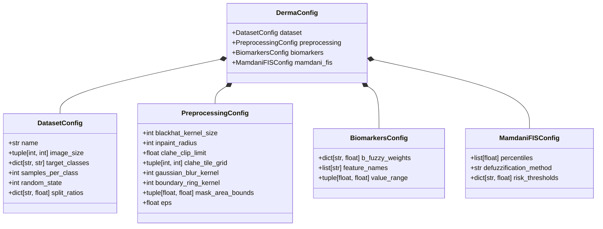

# Data Model: Walking Skeleton & Unified Configuration Engine

**Feature**: [001-walking-skeleton-config](spec.md) | **Date**: 2026-11-15

## Overview
This document defines the domain entities, immutable dataclasses, field attributes, constraints, and relationships governing the DermaFuzzy-XAI configuration system.

---

## Entity Diagram

---

## Entities Specification

### 1. `DatasetConfig`
Represents dataset ingestion, pre-filtering, and train/val/test partitioning.

- **Class definition**: `@dataclass(frozen=True, slots=True)`
- **Fields**:
  - `name: str` - Name of the dataset (e.g., `"HAM10000"`). Must be non-empty.
  - `image_size: tuple[int, int]` - Standardized dimensions `(width, height)`. Both must be positive integers (default: `(224, 224)`).
  - `target_classes: dict[str, str]` - Mapping of clinical diagnosis label to dataset code (default: `{"malignant": "mel", "benign": "nv"}`). Must contain at least two classes.
  - `samples_per_class: int` - Number of samples loaded per target category (default: `1000`). Must be $> 0$.
  - `random_state: int` - Seed for pseudo-random number generator (default: `42`).
  - `split_ratios: dict[str, float]` - Data partition ratios (default: `{"train": 0.70, "val": 0.15, "test": 0.15}`). Keys must include `train`, `val`, and `test`.
- **Validation Rules**:
  - $\sum_{k \in split\_ratios} split\_ratios[k] == 1.0 \pm 1e-6$.
  - All ratio values must satisfy $0.0 < ratio < 1.0$.

---

### 2. `PreprocessingConfig`
Governs dermoscopic artifact removal, lighting normalization, and morphological operations.

- **Class definition**: `@dataclass(frozen=True, slots=True)`
- **Fields**:
  - `blackhat_kernel_size: int` - Square structuring element size for morphological Black-Hat hair removal (default: `17`).
  - `inpaint_radius: int` - Telea inpainting radius in pixels (default: `3`). Must be $> 0$.
  - `clahe_clip_limit: float` - Contrast limit for adaptive histogram equalization (default: `2.0`). Must be $> 0.0$.
  - `clahe_tile_grid: tuple[int, int]` - Grid dimensions for CLAHE tile equalization (default: `(8, 8)`). Both entries must be positive integers.
  - `gaussian_blur_kernel: int` - Kernel diameter for Gaussian smoothing prior to thresholding (default: `5`).
  - `boundary_ring_kernel: int` - Structuring element size for morphological boundary dilation/erosion ring (default: `5`).
  - `mask_area_bounds: tuple[float, float]` - Permissible lesion relative area bounds `(min_area, max_area)` (default: `(0.02, 0.90)`).
  - `eps: float` - Denominator epsilon stabilizer to prevent zero-division (default: `1e-6`). Must be $> 0.0$.
- **Validation Rules**:
  - `blackhat_kernel_size`, `gaussian_blur_kernel`, and `boundary_ring_kernel` MUST be strictly positive odd integers ($k > 0 \land k \pmod 2 == 1$).
  - `mask_area_bounds` MUST satisfy $0.0 < min\_area < max\_area < 1.0$.

---

### 3. `BiomarkersConfig`
Defines parameters for extracting explainable ABCD clinical features.

- **Class definition**: `@dataclass(frozen=True, slots=True)`
- **Fields**:
  - `b_fuzzy_weights: dict[str, float]` - Relative weights between geometric border score and gradient-transition uncertainty (default: `{"w_geo": 0.5, "w_grad": 0.5}`).
  - `feature_names: list[str]` - Canonical ordered list of biomarker names (default: `["A", "B_fuzzy", "C", "D_verified"]`).
  - `value_range: tuple[float, float]` - Normalized clinical score bounds (default: `(0.0, 1.0)`).
- **Validation Rules**:
  - `w_geo + w_grad == 1.0 \pm 1e-6` and both weights must be $\ge 0.0$.
  - `feature_names` must contain exactly the 4 required biomarkers.
  - `value_range` must equal `(0.0, 1.0)` in adherence to Constitution Principle II.

---

### 4. `MamdaniFISConfig`
Configures the Mamdani Fuzzy Inference System for interpretable risk scoring.

- **Class definition**: `@dataclass(frozen=True, slots=True)`
- **Fields**:
  - `percentiles: list[float]` - Calibration percentile markers for Low/Medium/High fuzzy partition boundaries (default: `[25, 50, 75]`).
  - `defuzzification_method: str` - Defuzzification strategy (default: `"centroid"`). Permitted options: `["centroid", "bisector", "mom"]`.
  - `risk_thresholds: dict[str, float]` - Output risk triage limits on scale $[0, 100]$ (default: `{"low_max": 35.0, "medium_max": 65.0}`).
- **Validation Rules**:
  - `percentiles` must be strictly monotonically increasing ($0 < p_1 < p_2 < \dots < 100$).
  - `risk_thresholds["low_max"] < risk_thresholds["medium_max"]`.

---

### 5. `DermaConfig`
Aggregate root domain entity holding all configuration sections.

- **Class definition**: `@dataclass(frozen=True, slots=True)`
- **Fields**:
  - `dataset: DatasetConfig`
  - `preprocessing: PreprocessingConfig`
  - `biomarkers: BiomarkersConfig`
  - `mamdani_fis: MamdaniFISConfig`
