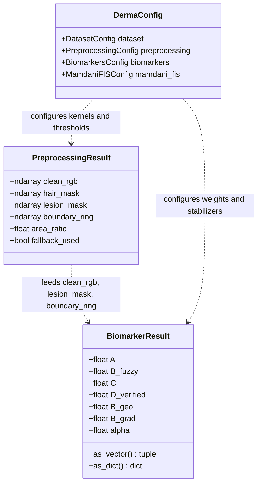

# Data Model: Production OpenCV Preprocessing & Saliency-Verified ABCD Biomarkers

**Feature**: [002-opencv-abcd-biomarkers](spec.md) | **Date**: 2026-11-15

## Overview
This document specifies the data entities, immutable containers, and buffer state constraints for Room 2 (`preprocessing.py`) and Room 3 (`biomarkers.py` and `gradcam.py`).

---

## Entity Diagram

---

## Entity Specifications

### 1. `PreprocessingResult`

Encapsulates the preprocessed imagery, intermediate artifact masks, and segmentation outputs with read-only array protections.

- **Class Definition**: `@dataclass(frozen=True, slots=True)`
- **Module**: `packages/dermafuzzy_core/preprocessing.py`
- **Fields**:
  - `clean_rgb: np.ndarray`: Cleaned, illumination-equalized RGB image.
    - Type: `np.uint8`, shape `(H, W, 3)`.
    - Constraint: `clean_rgb.flags.writeable == False`.
  - `hair_mask: np.ndarray`: Binary hair fiber detection mask.
    - Type: `np.uint8`, shape `(H, W)`, values in `{0, 255}`.
    - Constraint: `hair_mask.flags.writeable == False`.
  - `lesion_mask: np.ndarray`: Segmented primary lesion mask ($M$).
    - Type: `np.uint8`, shape `(H, W)`, values in `{0, 1}`.
    - Constraint: `lesion_mask.flags.writeable == False`.
  - `boundary_ring: np.ndarray`: Morphological perilesional boundary band ($R_{edge}$).
    - Type: `np.uint8`, shape `(H, W)`, values in `{0, 1}`.
    - Constraint: `boundary_ring.flags.writeable == False`.
  - `area_ratio: float`: Ratio of segmented lesion pixels to total image pixels ($M.sum() / (H \cdot W)$).
    - Constraint: $0.0 < \text{area\_ratio} \le 1.0$.
  - `fallback_used: bool`: Flag indicating whether the deterministic elliptical fallback was triggered due to an out-of-bounds area ratio.

---

### 2. `BiomarkerResult`

Encapsulates normalized, explainable ABCD feature extractions and spatial attention metrics.

- **Class Definition**: `@dataclass(frozen=True, slots=True)`
- **Module**: `packages/dermafuzzy_core/biomarkers.py`
- **Fields**:
  - `A: float`: Asymmetry score, normalized in $[0.0, 1.0]$.
  - `B_fuzzy: float`: Combined fuzzy border irregularity score, normalized in $[0.0, 1.0]$.
  - `C: float`: Multi-channel color variation score, normalized in $[0.0, 1.0]$.
  - `D_verified: float`: Attention-verified deep learning confidence score, normalized in $[0.0, 1.0]$.
  - `B_geo: float`: Geometric circularity deficit score, normalized in $[0.0, 1.0]$.
  - `B_grad: float`: Perilesional rim gradient fuzziness score, normalized in $[0.0, 1.0]$.
  - `alpha: float`: Saliency attention overlap proportion, normalized in $[0.0, 1.0]$.
- **Methods**:
  - `as_vector() -> tuple[float, float, float, float]`: Returns the 4-element biomarker tuple `(A, B_fuzzy, C, D_verified)`.
  - `as_dict() -> dict[str, float]`: Returns a mapping of all 7 computed biomarker components to their respective values.
