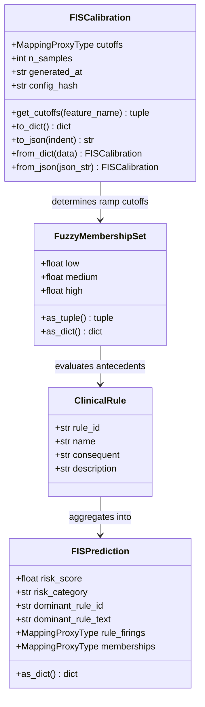

# Data Model: Data-Calibrated Mamdani Fuzzy Inference System & Metamorphic QA

**Feature**: [003-mamdani-fis-metamorphic-qa](spec.md)  
**Date**: 2026-11-15  
**Status**: Completed  

---

## 1. Domain Entities



---

## 2. Entity Specifications

### 2.1 `FISCalibration`
Immutable container storing empirical percentiles ($P_{25}, P_{50}, P_{75}$) per biomarker.

```python
@dataclass(frozen=True, slots=True)
class FISCalibration:
    cutoffs: Mapping[str, tuple[float, float, float]]  # MappingProxyType
    n_samples: int
    generated_at: str                                   # ISO 8601 UTC
    config_hash: str                                    # SHA-256 digest
```

#### Invariants & Validation Rules
- `cutoffs` MUST contain exactly keys `{"A", "B_fuzzy", "C", "D_verified"}`.
- Every cutoff tuple `(p25, p50, p75)` MUST satisfy:
  - $0.0 < p_{25} < p_{50} < p_{75} < 1.0$
  - $p_{50} - p_{25} \ge 1e-4$
  - $p_{75} - p_{50} \ge 1e-4$
- `n_samples` MUST be an integer $\ge 4$ (non-boolean).
- All mapping access is read-only via `types.MappingProxyType`.

---

### 2.2 `FuzzyMembershipSet`
Represents the linguistic degree of membership for a single biomarker across the 3 terms.

```python
@dataclass(frozen=True, slots=True)
class FuzzyMembershipSet:
    low: float
    medium: float
    high: float
```

#### Invariants & Validation Rules
- Each of `low`, `medium`, `high` MUST be a finite float in $[0.0, 1.0]$.
- Partition of Unity: `math.isclose(low + medium + high, 1.0, abs_tol=1e-5)` MUST be `True`.

---

### 2.3 `ClinicalRule`
Static metadata defining one of the 5 canonical clinical Mamdani rules.

```python
@dataclass(frozen=True, slots=True)
class ClinicalRule:
    rule_id: str      # e.g., "R1"
    name: str         # e.g., "Classic ABCD Malignant"
    consequent: str   # "High", "Medium", or "Low"
    description: str  # Clinical explanation
```

#### Canonical Rules Table
| Rule ID | Rule Name | Antecedent Formula | Consequent | Clinical Meaning |
|---|---|---|---|---|
| `R1` | Classic ABCD Malignant | `min(H(A), H(B_fuzzy), H(C))` | `High` | Classic asymmetry, fuzzy border, and color variation. |
| `R2` | Deep-Verified Malignant | `min(H(B_fuzzy), H(C), H(D_verified))` | `High` | Peripheral irregularity and verified CNN attention. |
| `R3` | Early Structural Malignant | `min(max(H(A), H(B_fuzzy)), H(D_verified))` | `High` | Early asymmetry or border irregularity with deep attention. |
| `R4` | Borderline Dysplastic Nevus | `max(min(M(B), M(C), M(D)), mean(M))` | `Medium` | Moderate clinical features requiring follow-up. |
| `R5` | Benign Nevus & Artifact Guard | `min(L(A), L(B), L(C), max(L(D), M(D)))` | `Low` | Clean benign lesion protected against ruler artifacts. |

---

### 2.4 `FISPrediction`
Final explainable diagnostic decision artifact.

```python
@dataclass(frozen=True, slots=True)
class FISPrediction:
    risk_score: float                                      # in [0.0, 100.0]
    risk_category: str                                    # "Low", "Medium", "High"
    dominant_rule_id: str                                 # e.g., "R1"
    dominant_rule_text: str                               # Full explanation
    rule_firings: Mapping[str, float]                     # MappingProxyType
    memberships: Mapping[str, Mapping[str, float]]        # MappingProxyType
```

#### Invariants & Validation Rules
- `risk_score` MUST be a finite float in $[0.0, 100.0]$.
- `risk_category` MUST be one of `{"Low", "Medium", "High"}`:
  - `"Low"` if `risk_score <= config.mamdani_fis.risk_thresholds["low_max"]` (35.0)
  - `"Medium"` if `35.0 < risk_score < 65.0`
  - `"High"` if `risk_score >= config.mamdani_fis.risk_thresholds["medium_max"]` (65.0)
- `dominant_rule_id` MUST correspond to the rule with the highest firing strength. In case of ties, priority follows `R1 > R2 > R3 > R4 > R5`.
- `rule_firings` and `memberships` are deeply immutable.
