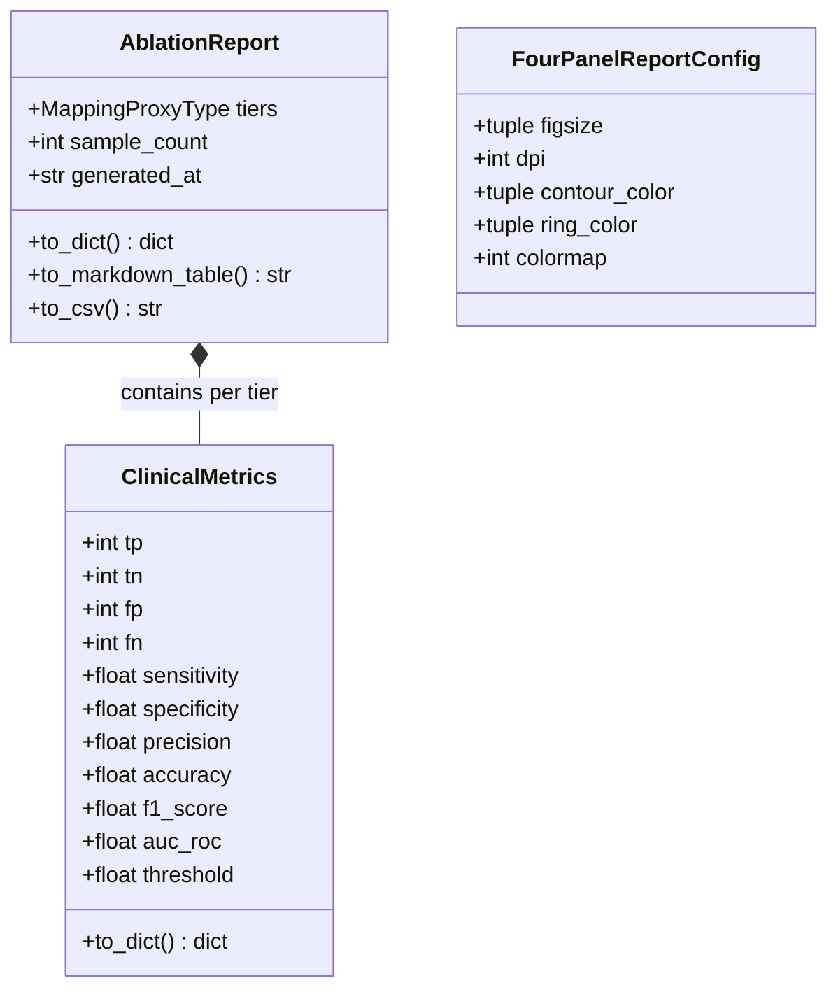

# Data Model: Clinical Evaluation, 3-Tier Ablation Study & Visualizer

**Feature**: [004-ablation-visualizer-colab-ci](spec.md)  
**Date**: 2026-11-15  
**Status**: Completed  

---

## 1. Domain Entities Overview



---

## 2. Entity Specifications

### 2.1 `ClinicalMetrics`
Immutable container storing quantitative biostatistical classification metrics.

```python
@dataclass(frozen=True, slots=True)
class ClinicalMetrics:
    tp: int
    tn: int
    fp: int
    fn: int
    sensitivity: float
    specificity: float
    precision: float
    accuracy: float
    f1_score: float
    auc_roc: float
    threshold: float = 0.50
```

#### Invariants & Validation Rules
- All counts (`tp, tn, fp, fn`) MUST be non-negative integers (rejecting `bool`).
- All rates (`sensitivity, specificity, precision, accuracy, f1_score, auc_roc, threshold`) MUST be finite floats bounded in $[0.0, 1.0]$.
- Denominators are protected by an epsilon stabilizer ($\epsilon = 1e-6$) or zero-division guards.

---

### 2.2 `AblationReport`
Immutable container consolidating results across the 3 diagnostic tiers.

```python
@dataclass(frozen=True, slots=True)
class AblationReport:
    tiers: Mapping[str, ClinicalMetrics]  # MappingProxyType
    sample_count: int
    generated_at: str                      # ISO 8601 UTC
```

#### Canonical Tiers
1. `1_pure_mobilenetv2_blackbox`: Direct CNN softmax confidence $p_{cnn}$.
2. `2_crisp_abcd_fixed_thresholds`: Hard binary indicator thresholds at median $P_{50}$.
3. `3_proposed_dermafuzzy_xai`: Saliency-gated Mamdani FIS continuous risk score.

#### Export Formats
- `to_markdown_table() -> str`: Formatted GitHub Markdown table displaying Accuracy, Sensitivity, Specificity, Precision, F1-Score, and AUC-ROC with percentages.
- `to_csv() -> str`: Standard comma-separated values for statistical analysis software.

---

### 2.3 `FourPanelReportConfig`
Rendering options for the publication-grade visual explanation generator.

```python
@dataclass(frozen=True, slots=True)
class FourPanelReportConfig:
    figsize: tuple[float, float] = (16.0, 4.5)
    dpi: int = 300
    contour_color: tuple[int, int, int] = (0, 255, 0)
    ring_color: tuple[int, int, int] = (0, 255, 255)
    heatmap_alpha: float = 0.35
```
